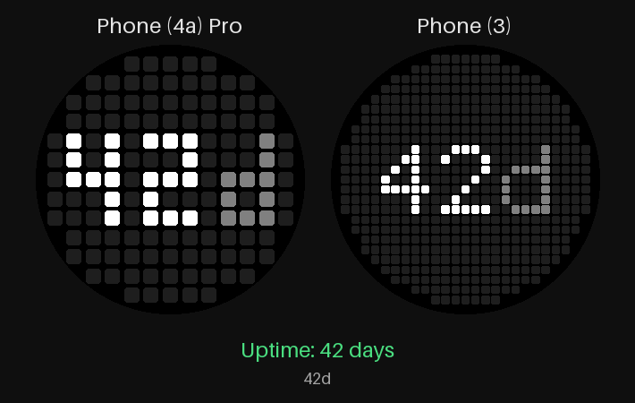

# Server Status – Glyph Toy für Proxmox

Glyph Toy für die Glyph Matrix (Nothing Phone (3) 25×25, Phone (4a) Pro 13×13).
Der Toy zeigt, ob dein Proxmox-Server erreichbar ist:

- **UP**: Die Matrix wechselt zwischen den Ansichten, die du in der App unter *Anzeige auf der Matrix* auswählst
  (Standard: Uptime, VMs/LXC, Uhr). Wechselzeit 3–60 s, Änderungen gelten sofort, auch bei laufendem Toy.

  | Ansicht | Anzeige | Designs |
  |---|---|---|
  | Uptime | `42d` (unter einem Tag `5h`) | – |
  | VMs/LXC | `7/9`, ab zweistellig als Bruch `12` über `15` | Text · Punkte (1 Punkt pro VM/LXC: hell = läuft, gedimmt = gestoppt, blinkt = gesperrt) |
  | CPU | `C35` | Text · Ring (Anteil am Rand) · Verlauf (letzte Minuten als Balken) |
  | RAM | `R62` | Text · Ring · Verlauf |
  | Load | `L0.5` (1 min) | – |
  | Disk | `D47` = alle Storages mit VM-Disks/Containern zusammen | Text · Ring |
  | Netz | `N12` = in + out in Mbit/s | – |
  | Backup | `B✓` / `B✗` = letzter beendeter vzdump-Job | – |
  | Updates | `U12` / `U✓` | – |
  | Disk-Health | `HD✓` / `HD✗` = SMART-Status aller Platten + ZFS-Pools; nur alle 30 min abgefragt | – |
  | Quorum | `Q✓` / `Q✗`, nur bei Clustern | – |
  | Uhr | `12` / `34` | – |

  Im Ring-Design zeigt das 13×13-Display nur die Zahl (der Buchstabe würde den Ring berühren).
- **DOWN**: blinkendes X = Server antwortet nicht, meldet einen Fehler oder ein Node ist offline.
  ⊘ = das Handy hat gar kein Netz. `VPN` = der Host ist eine Tailscale-Adresse (100.64.0.0/10 oder `*.ts.net`),
  aber auf dem Handy ist kein VPN aktiv.

Weitere Einstellungen in der App:

- **Nur Uhrzeit**: statt der Rotation nur die Uhr (Server-DOWN hat weiter Vorrang). Umschalten per Häkchen in der App,
  per zweitem App-Symbol **„Uhr ⇄ Rotation“** (öffnet kein Fenster – geeignet für eine Taste, die „App öffnen“ kann),
  per Schnelleinstellungs-Kachel oder auf dem Phone (3) per langem Druck auf den Glyph-Button.
- **Helligkeit**: Schieberegler 10–100 % für die ganze Matrix; die Matrix folgt beim Schieben sofort.
- **Helligkeit nach Auslastung**: CPU/RAM/Disk unter 50 % gedimmt, ab 80 % volle Helligkeit.
- **Warnungen**: Schwellen für CPU, RAM und Disk; außerdem fehlgeschlagenes Backup, Disk-Fehler, verlorenes Quorum.
  Modus *nur Warnungen zeigen* (Rotation nur noch über die kritischen Werte) oder
  *Warnungen dazwischenschieben* (nach jeder normalen Ansicht eine Warnung).
- **Nachtruhe**: Matrix im gewählten Zeitraum aus, außer der Server ist down oder eine Disk meldet einen Fehler.
- **Zuverlässigkeit**: Knopf zum Abschalten der Akku-Optimierung (sonst sperrt Android der App im Ruhezustand/Doze
  nach ca. 30 min das Netz, und die Matrix zeigt „kein Netz“ – für Tailscale ebenfalls abschalten).
  *DOWN erst nach N Fehlversuchen* (Standard 2): einzelne Verbindungsaussetzer lassen den letzten guten Stand stehen;
  meldet der Server selbst ein Problem (Node offline, HTTP-Fehler), gilt das sofort.
  *Abfrage-Protokoll*: die letzten 50 Abfragen mit Ergebnis, Netz-, VPN- und Akku-Status.

- **Plugins**: eigene Datenquellen (beliebige HTTPS-API, Proxmox-Pfade) oder neue Designs für vorhandene Werte,
  als JSON-Datei per *Datei importieren* oder *Aus Zwischenablage*. Plugins enthalten keinen Code; Tokens fragt die
  App beim Import ab und speichert sie verschlüsselt. Anleitung für Menschen und KIs: **[docs/PLUGINS.md](docs/PLUGINS.md)**,
  Beispiele in [plugins/examples/](plugins/examples).



Beim Aktivieren des Toys und bei jedem AOD-Event (ca. 1× pro Minute) wird `GET {host}/api2/json/nodes` abgefragt
(Status, Uptime, CPU, RAM). Nur wenn eine Ansicht, ein Design oder die Warnungen es brauchen, kommen hinzu:

| Daten | Abfrage | Recht |
|---|---|---|
| VMs/LXC, Disk | `/cluster/resources` | VM.Audit, Datastore.Audit |
| Load | `/nodes/{node}/status` | Sys.Audit |
| Netz, CPU-/RAM-Verlauf | `/nodes/{node}/rrddata?timeframe=hour&cf=AVERAGE` | Sys.Audit |
| Backup | `/cluster/tasks` | Sys.Audit |
| Disk-Health | `/nodes/{node}/disks/list`, `/nodes/{node}/disks/zfs` | Sys.Audit |
| Quorum | `/cluster/status` | Sys.Audit |
| Updates | `/nodes/{node}/apt/update` | **Sys.Modify** – nicht in PVEAuditor |

Die Rolle PVEAuditor deckt alles außer den Updates ab. Proxmox verlangt für die Update-Liste `Sys.Modify`, ein
Schreibrecht auf den Node; mit dem empfohlenen Read-only-Token wird die Ansicht deshalb übersprungen, und
„Jetzt testen“ meldet das. Fehlen Daten, wird die jeweilige Ansicht übersprungen; der Status bleibt UP.

Nicht möglich über die API: **Temperaturen** (Proxmox liefert keine Sensordaten) und **„Neustart nötig“**.

## 1. API-Token in Proxmox anlegen

Lege einen eigenen User mit reinen Leserechten an, statt `root@pam` zu verwenden.

1. **Datacenter → Permissions → Users → Add**: User `glyph`, Realm `Proxmox VE authentication server` (`pve`).
2. **Datacenter → Permissions → Add → User Permission**: Path `/`, User `glyph@pve`, Role **PVEAuditor**, Propagate aktiviert.
3. **Datacenter → Permissions → API Tokens → Add**: User `glyph@pve`, Token ID `status`.
   Das Secret wird nur einmal angezeigt – sofort kopieren.

**Privilege Separation:** Ist sie beim Token aktiviert (Standard), hat der Token *keine* eigenen Rechte,
auch wenn der User welche hat. Dann musst du die Rolle zusätzlich dem Token geben:
**Permissions → Add → API Token Permission**, Path `/`, Token `glyph@pve!status`, Role `PVEAuditor`.
Alternativ Privilege Separation beim Anlegen deaktivieren; dann erbt der Token die Rechte des Users.
Ohne Rechte liefert `/nodes` eine leere Liste, und der Toy zeigt DOWN.

Test auf der Kommandozeile:

```sh
curl -k -H 'Authorization: PVEAPIToken=glyph@pve!status=<SECRET>' https://192.168.1.10:8006/api2/json/nodes
```

## 2. Zertifikat-Fingerprint auslesen

Proxmox verwendet ein selbstsigniertes Zertifikat. Damit die App es akzeptiert, wird es per SHA-256-Fingerprint gepinnt.

- GUI: **Datacenter → *Node* → System → Certificates**, dort den Eintrag `pveproxy-ssl.pem`
  (falls vorhanden, sonst `pve-ssl.pem`) markieren → **View Certificate** → Feld *Fingerprint* kopieren.
- Oder auf dem Node: `openssl x509 -in /etc/pve/local/pve-ssl.pem -noout -fingerprint -sha256`

Der Fingerprint kann mit oder ohne Doppelpunkte eingetragen werden. Die App akzeptiert dann **nur** genau
dieses Zertifikat. Bleibt das Feld leer, gelten die normalen System-CAs (z. B. für ein Let's-Encrypt-Zertifikat).
Wird das Zertifikat erneuert, musst du den neuen Fingerprint eintragen.

## 3. APK bauen, installieren und Toy aktivieren

```sh
./gradlew assembleDebug
adb install -r app/build/outputs/apk/debug/app-debug.apk
```

1. App **Server Status** öffnen, Host-URL (z. B. `https://192.168.1.10:8006`), Token-ID (`glyph@pve!status`),
   Secret und Fingerprint eintragen → **Speichern** → **Jetzt testen**.
2. **Glyph Toys verwalten** antippen (oder *Einstellungen → Glyph Interface*) und *Server Status*
   von *Disabled* nach *Active* ziehen.
3. Für die Anzeige im Always-on-Modus: *Einstellungen → Glyph Interface → Flip to Glyph → Always-on Glyph Toy*
   → *Server Status* wählen. Auf dem Phone (4a) Pro gibt es nur AOD-Toys.

## Projekt

- `app/libs/glyph-matrix-sdk-2.0.aar` – Glyph Matrix SDK aus dem
  [GlyphMatrix-Developer-Kit](https://github.com/Nothing-Developer-Programme/GlyphMatrix-Developer-Kit)
- `StatusToyService` – Glyph-Toy-Service (Bind/Unbind, AOD-Event, Rotation, Blinken)
- `Screens` – was wann angezeigt wird (Ansichten, Designs, Warnungen, Nachtruhe, DOWN-Gründe)
- `MatrixText` / `MatrixGraphics` – Pixel-Schrift 3×5 bzw. 5×7, Ring, Verlauf, Punkte, ⊘
- `Connectivity` – unterscheidet „kein Netz“ / „VPN aus“ von „Server down“
- `plugin/` – Plugin-Format, Validierung, Abruf, Darstellung und Speicherung (siehe docs/PLUGINS.md)
- `ProxmoxClient` – HTTP-Abfrage (OkHttp, 5 s Timeout) und Zertifikat-Pinning
- `MatrixIcons` – DOWN-Icon für 25×25 und 13×13 und die runde Sichtbarkeitsmaske
- `SettingsActivity` / `Storage` – Einstellungen; Zugangsdaten in EncryptedSharedPreferences, Anzeige-Auswahl und Wechselzeit in normalen SharedPreferences
